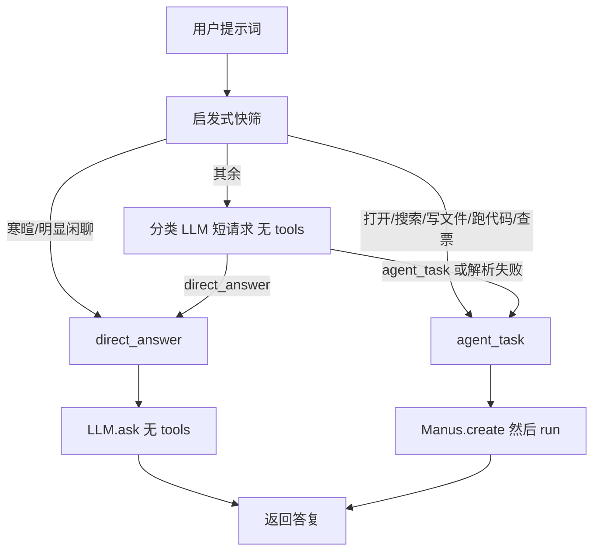

# 意图识别层设计

> 目标：让寒暄、常识、日期等简单问题直接调用大模型返回答复，不再进入 Manus 的 ReAct 工具循环。需要浏览、写文件、跑代码、实时数据的任务，仍走现有 Agent。

## 1. 背景：为什么简单问题也会很慢

当前 `main.py` / `app.py` 只创建 **Manus**。所有用户输入都进入同一套循环：

```
think(ask_tool，带全部工具 schema) → act(执行工具) → Observation 回写 Memory → think …
直到调用 terminate 或达到 max_steps=20
```

机制上有三个强制点：

1. **没有直答路径**。角色提示和 `NEXT_STEP_PROMPT`（`app/prompt/manus.py`）都在要求「选工具」；`FINISHED` 只在执行特殊工具 `terminate` 时置位（`app/agent/toolcall.py`）。
2. **每一步 = 一次完整 LLM 往返**。日期本身一行 Python 就能拿到，却至少要：调 `python_execute` → 下一轮组织答复 → 再调 `terminate`，所以常见是 3 步。
3. **天气没有搜索/天气 API**。Manus 工具只有 `PythonExecute` / `StrReplaceEditor` / `AskHuman` / `Terminate` + MCP 的 `browser_exec` / `browser_screenshot`。查天气等于整页浏览器自动化，再叠加「先 `datetime.now()` 对齐日期、先观察再操作、等 XHR」等规则，容易到 10+ 步。

`app.py` 使用 `Manus()` 而非 `Manus.create()`，第一次 `think()` 还会懒加载 MCP / 拉起 browser-use。简单问答根本用不到浏览器，却可能先付一笔启动成本。

因此要在 **`agent.run(prompt)` 之前** 分流，而不是改 `think()` 内部。

## 2. 设计原则

- **只挡入口，不改循环**。`ToolCallAgent` / Manus / 浏览器规则维持现状，避免回归已修好的浏览器行为。
- **拿不准就走 Agent**。漏一次工具的代价，大于多走一轮 ReAct。
- **直答不要创建 Manus**。一旦 `Manus.create()` 或第一次 `think()`，仍会连 MCP。
- **PlanningFlow 不走闸门**。`run_flow.py` 的步骤已经是拆好的执行指令，再分类会把「第 3 步写文件」误判成问答。

## 3. 总体流程



## 4. 意图定义（先做二元，不要拆太细）

| 意图 | 含义 | 路径 |
| --- | --- | --- |
| `direct_answer` | 寒暄、常识、概念解释、翻译、改写、数学口算；不依赖实时网页、本地文件、当前系统之外的状态 | `LLM.ask()` |
| `agent_task` | 浏览、搜索、查票、写文件、跑代码、需要「今天/明天」的真实外部数据（天气、股价、新闻） | 现有 Manus |

「今天星期几」可直答（再由直答模型自己决定要不要信训练日期，或调用方在 system 里注入 `datetime.now()`）。  
「明天北京天气」必须 `agent_task`：需要实时外部数据。

第二期如有需要，再把 `agent_task` 拆成 search / browser / code，当前不做。

## 5. 分类器

### 5.1 启发式快筛（可选，省一次 LLM）

命中则不再调分类模型：

- 走 `agent_task` 的关键词示例：打开、搜索、访问、下载、写入、保存到、运行代码、12306、浏览器、截图、爬取。
- 走 `direct_answer` 的示例：你好、谢谢、你是谁、简单翻译/改写且无 URL。
- 含 URL、文件路径、`http`、`workspace/` → `agent_task`。
- 其余交给分类 LLM。

快筛只做高置信，低置信必须交给模型。

### 5.2 分类 LLM

- 调用现有 `LLM.ask()`，**不传 tools**，`stream=False`。
- 可用同一套 `[llm]` 配置；若以后有更便宜的分类模型，再加独立 `config_name`。
- 输入：仅用户原提示词。
- 输出：严格 JSON，例如 `{"intent":"direct_answer","reason":"..."}`。
- 解析失败、超时、非枚举值 → `agent_task`。

分类提示词单独放 `app/prompt/intent.py`，与 Manus 角色提示解耦。规则要点：

- 需要实时、外部、本地文件/命令行/浏览器的，一律 `agent_task`。
- 天气、股价、新闻、票务、网页现状 → `agent_task`。
- 只输出 JSON，不要解释。

## 6. 直答路径

- 使用单独的 `DIRECT_ANSWER_SYSTEM`（`app/prompt/intent.py`），**禁止**复用 `app/prompt/manus.py` 的「请选工具」。
- 建议在 system 中注入当前服务器时间（`datetime.now()`），避免「今天」再绕到 Python 工具。
- 不知道就说不知道，不要假装搜过网。
- 调用 `LLM.ask(messages, system_msgs=..., stream=False)`。
- 不创建 Manus，不连 MCP，不写 `next_step_prompt`。

可选第二期：若直答文本明确表示「需要上网/打开文件」，再 fallback 进 Manus。

## 7. 代码落点

建议新增，而不是改 `toolcall.py`：

| 文件 | 职责 |
| --- | --- |
| `app/prompt/intent.py` | 分类 system、直答 system |
| `app/agent/intent.py` | `IntentGate.classify()` / `handle()` |

`IntentGate.handle(prompt)` 伪代码：

```python
async def handle(self, prompt: str) -> str:
    intent = await self.classify(prompt)
    if intent == "direct_answer":
        return await self.llm.ask(
            [Message.user_message(prompt)],
            system_msgs=[Message.system_message(DIRECT_ANSWER_SYSTEM)],
            stream=False,
        )
    agent = await Manus.create()
    try:
        return await agent.run(prompt)
    finally:
        await agent.cleanup()
```

入口改造（仅这两处用户入口）：

- `main.py`：`await IntentGate().handle(prompt)`，不再直接 `Manus.create()`。
- `app.py` 的 `run_task()`：同样包一层。直答时 SSE 只推最终结果（可记一条 `type=result`），不要伪造 think/tool 事件；侧栏会话仍按一条任务存储。

不改：

- `app/agent/toolcall.py` 的 think/act
- `app/agent/manus.py` 的浏览器规则与 MCP 连接
- `run_flow.py` / `PlanningFlow`
- `sandbox_main.py`（沙箱入口保持原样，除非产品明确要求）

## 8. Web 行为

| 路径 | SSE | 侧栏 |
| --- | --- | --- |
| 直答 | 无逐步工具日志；完成后一条用户可读答复 | 一条会话，标题仍取提示词前 40 字 |
| Agent | 现有折叠 Thought process + 最终结果 | 不变 |

直答也应走 `extract_user_facing_result` 的反面：返回值本身就是用户答复，直接作为 `complete` 的 `result`。

## 9. 失败与观测

1. 分类异常 / JSON 失败 → `agent_task`。
2. 直答 LLM 失败 → 可降级 `agent_task`，或返回错误（Web 走现有 `fail_task`）。
3. 日志必须带 `intent=` 与 `reason=`，便于调分类提示词。
4. 建议统计：直答占比、直答后再被用户重问「你去搜一下」的比例（误伤指标）。

## 10. 明确不做（本期）

- 在 `think()` 里用 `tool_choice=none` 冒充直答（仍会带工具 schema 和「请选工具」）。
- 靠「本步没有 tool_calls」结束循环（那已经付了完整 Agent 请求的钱；且与必须 `terminate` 的现逻辑纠缠）。
- 一上来做多意图（闲聊 / 翻译 / 数学 / 搜索 / 浏览器）。
- 把 PlanningFlow 的每个子步骤再送进闸门。

## 11. 建议的后续（非本期必须）

- Agent 路径：若某步已有实质 `content` 且无 tool_calls，允许直接 `FINISHED`，少烧一次专门的 `terminate`。
- 为天气/搜索补 `WebSearch` 或天气 API，避免「明天天气」仍去开浏览器。
- `app.py` 在确认走 Agent 后再 `Manus.create()`，避免直答误伤后的重复初始化（`handle()` 已保证直答不创建 Manus）。

## 12. 验收用例

应走直答（1 次 LLM，无浏览器进程）：

- 「你好」
- 「用一句话解释什么是 ReAct」
- 「把这段话翻译成英文：…」（无 URL）
- 「今天星期几」（允许 system 注入服务器时间）

应走 Agent：

- 「打开 https://www.ecjtu.edu.cn/ 做 SEO 审查」
- 「查明天北京天气」
- 「帮我把报告写到 workspace/xxx.md」
- 「用浏览器查 12306 车票」

分类失败时必须落入 Agent，不能空返回。
